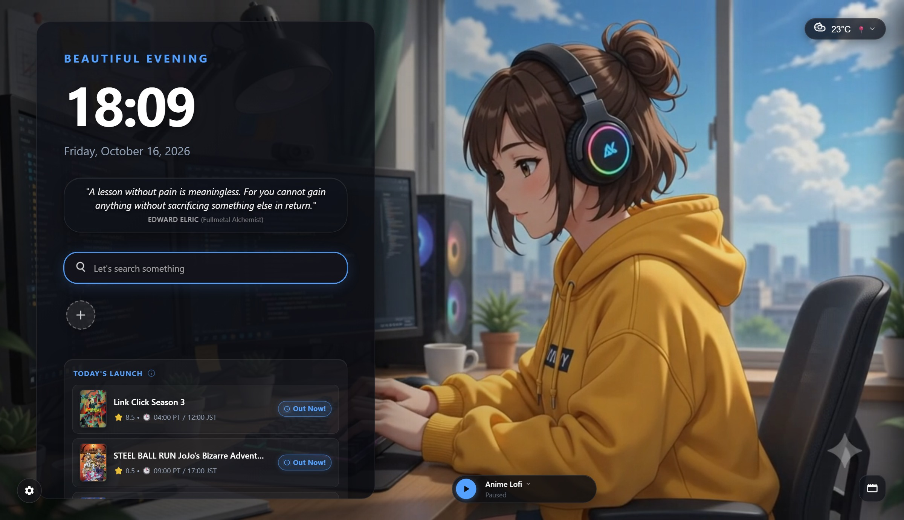
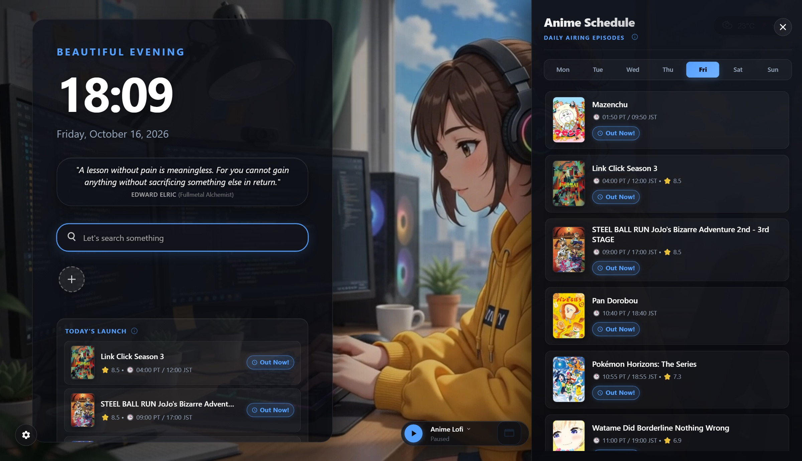
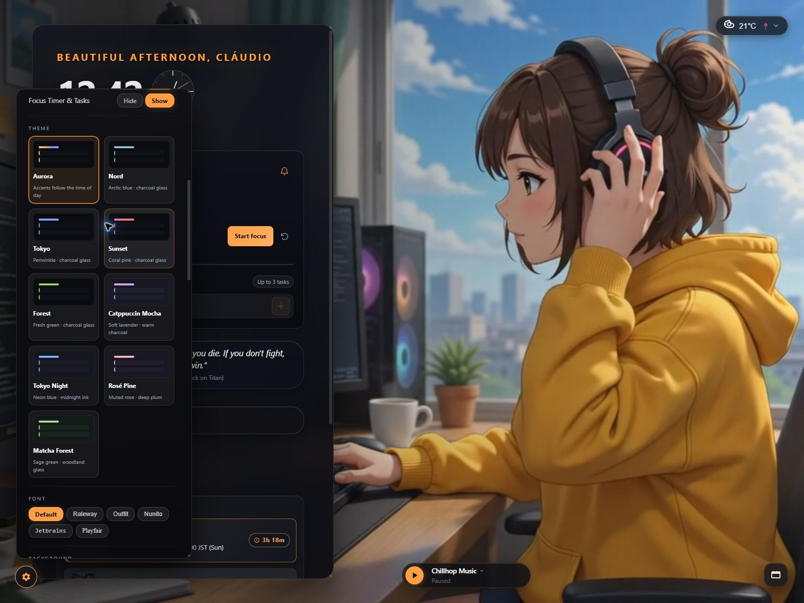
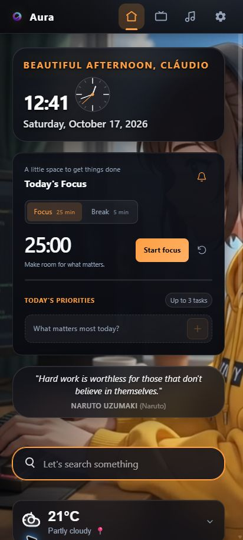
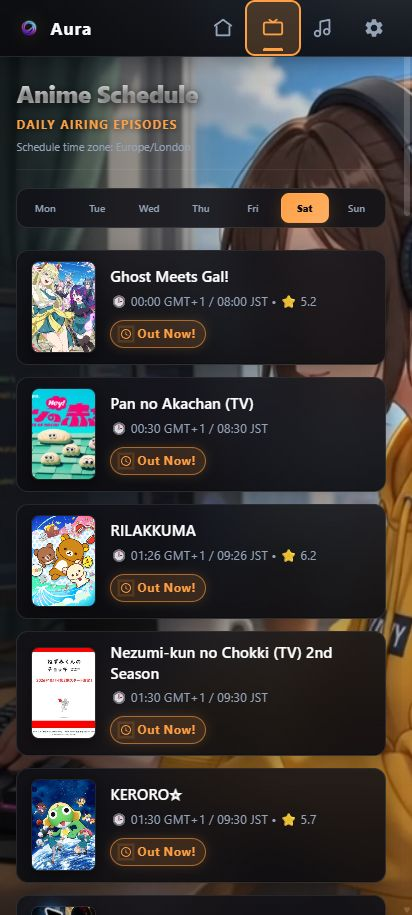

<div align="center">

# ✨ Good Morning — Aura Dashboard

**A cozy, local-first personal start page & productivity dashboard built with React, Vite, and glassmorphism.**  
Live anime airing schedules, MyAnimeList watchlist sync, ambient Lofi radio, weather forecasts, speed dials, and dynamic video wallpapers—compiled into a single self-contained HTML artifact.

[](https://claudiogarcia98.github.io/Aura-Dashboard/)
[](https://github.com/ClaudioGarcia98/Aura-Dashboard/releases/tag/v1.2.0)
[](https://github.com/ClaudioGarcia98/Aura-Dashboard/actions)
[](https://nodejs.org/)
[](https://buymeacoffee.com/claudio091s)
[](https://github.com/sponsors/ClaudioGarcia98)

</div>

---

## 🖥️ Visual Showcase

### Desktop Start Page (Aurora / Sunset Theme)


### Live Anime Schedule & Dynamic Glassmorphism Themes
| 📺 Weekly Anime Schedule (`AniList` + `MAL Sync`) | 🎨 Dynamic Themes & Settings (`Aurora`, `Nord`, `Tokyo`, `Sunset`, `Forest`) |
| :---: | :---: |
|  |  |

### Mobile-First Compact Tabbed Shell
| 📱 Mobile Home Tab | 📅 Mobile Anime Schedule Tab |
| :---: | :---: |
|  |  |

---

## 🌟 Feature Matrix

| Feature | What It Does | Storage & Providers |
| :--- | :--- | :--- |
| **🕰️ Smart Clock & Greeting** | Digital, analog, or dual clock (`12h` / `24h`) paired with time-of-day and weather-aware greetings (*Morning*, *Afternoon*, *Evening*, *Night*) and anime quotes. | Local system clock + `Zustand` (`dash_settings`) |
| **📺 Live Anime Airing Tracker** | Displays **Today's Launch (Top 5)** on the main dashboard and a full **7-day airing calendar** converted automatically to Portugal (`Europe/Lisbon`) and Japan (`JST`) times with live countdown badges. | **AniList GraphQL API** + cached stale-safe fallback |
| **🔗 MyAnimeList Watchlist Sync** | Connects any public MyAnimeList username—no login or API key required—and highlights every airing show on your `Watching` list with a glowing **`★ MY LIST`** badge. | Local Vite proxy (`/api/mal`) in dev · Dedicated **Cloudflare Worker v4** in prod |
| **🎬 Device-Adaptive Trailers** | Hovering an anime card on desktop opens a floating YouTube trailer portal; expanding a card on touch/mobile embeds a responsive `16:9` trailer with automatic teardown on collapse. | YouTube IFrame API (origin-verified) |
| **🎧 Persistent Lofi Radio** | Built-in YouTube Lofi stream player with curated stations, custom station URL support, shared global volume/mute memory, and uninterrupted playback when switching between desktop and mobile layouts. | YouTube IFrame API + `localStorage` |
| **⛅ Weather & 3-Day Forecast** | Current conditions (`°C` / `°F`), expandable 3-day forecast, and automatic location resolution with GPS, IP geolocation, and custom fallback city support. | **Open-Meteo API** + location/units-keyed cache |
| **🔍 Prefix Search & Speed Dials** | Multi-engine search bar with quick prefixes (`g `, `yt `, `mal `, `gh `, `r `), keyboard history navigation, opt-in data-only search suggestions, and reorderable bookmark Speed Dials. | Local history + `dash_settings` |
| **🎨 Dynamic Glassmorphism & Video Wallpapers** | 5 reactive color themes (*Aurora*, *Nord*, *Tokyo*, *Sunset*, *Forest*) powered by CSS `color-mix()`, 6 typography presets (*Default*, *Raleway*, *Outfit*, *Nunito*, *JetBrains*, *Playfair*), and custom image/video wallpaper uploads stored offline. | **IndexedDB** (`dashDB`) for media + CSS custom properties |
| **💾 Versioned Backups & Clean Reset** | One-click JSON export/import of validated settings and bookmarks, plus an Aura-scoped reset that cleanly restores first-time visitor defaults without touching unrelated browser storage. | Guarded `safeStorage` adapter |

---

## ⚡ Quick-Start Guide

### Prerequisites
- **Node.js `22.12+`** and `npm`

### 1. Clone & Install
```sh
git clone https://github.com/ClaudioGarcia98/Aura-Dashboard.git
cd Aura-Dashboard
npm ci
```

### 2. Start the Local Development Server
```sh
npm run dev
```
Open the local URL shown in your terminal (default `http://localhost:5173`). In development, Vite automatically proxies `/api/mal` requests directly to MyAnimeList.

### 3. Available Scripts

| Command | Description |
| :--- | :--- |
| `npm run dev` | Start the local Vite development server with HMR and `/api/mal` proxy |
| `npm run lint` | Run ESLint across all JavaScript and React files |
| `npm test` | Run the full Vitest unit & integration suite (`526 tests` across `43 files`) |
| `npm run build` | Package the app into a single self-contained `dist/index.html` and verify CSP hashes |
| `npm run preview` | Serve the production `dist/index.html` bundle locally |
| `npm audit` | Check dependency security advisories |

---

## 🛠️ Personalizing Your Dashboard

1. **Set Your Display Name & MAL Profile**: Click the **⚙️ Settings** gear (bottom-left on desktop, top bar on mobile) and enter your display name and public **MyAnimeList username** to highlight your airing shows.
2. **Customize Themes & Wallpapers**: Under **Theme & Typography** and **Background Media**, switch between *Aurora*, *Midnight*, *Ocean*, and *Cyberpunk* palettes or upload your own `.mp4` / `.webm` / image wallpaper (stored locally in IndexedDB).
3. **Use Search Shortcuts**: Press `Ctrl + Space` anywhere on desktop to focus the search bar, or type a prefix (`/yt lofi hip hop`, `/mal frieren`, `/gh react`) to jump straight to your target search engine.
4. **Backup Your Setup**: Scroll to **Backup & Restore** in Settings to export a portable `.json` snapshot of your speed dials, custom stations, and preferences.

---

## 🔒 Privacy, Security & Architecture

- **100% Local-First**: Settings, speed dials, and API caches live in your browser's `localStorage`; custom video/image backgrounds live in `IndexedDB`. No user account or cloud database is required.
- **Privacy by Default**: Online search suggestions are **off by default** and use inert JSON requests only when explicitly enabled. MyAnimeList sync sends only the public username you type—never credentials or cookies.
- **Single-File Production Artifact**: `scripts/single-file.js` compiles all JS, CSS, fonts metadata, and default media into a single `dist/index.html` (< 5 MB) with strict `sha256` Content-Security-Policy (`CSP`) script hashes verified by `scripts/check-build.js`.
- **Dedicated MAL Worker Relay**: Production builds on GitHub Pages connect to a hardened Cloudflare Worker ([`workers/mal/`](workers/mal/README.md)) featuring per-IP rate limiting, request coalescing, upstream timeouts, and per-user edge caching.

---

## ☕ Support the Project

**Good Morning (Aura)** is free to use. If it brightens your daily workflow or anime tracking, consider supporting its continued development:

- ☕ [**Buy Me a Coffee**](https://buymeacoffee.com/claudio091s)
- 💖 [**GitHub Sponsors (`@ClaudioGarcia98`)**](https://github.com/sponsors/ClaudioGarcia98)

---

## 📄 License

Copyright © 2026 Cláudio Garcia. All Rights Reserved.  
This project and its source code are proprietary. See [LICENSE](LICENSE) for full terms, and [SECURITY.md](.github/SECURITY.md) for repository security policies.
