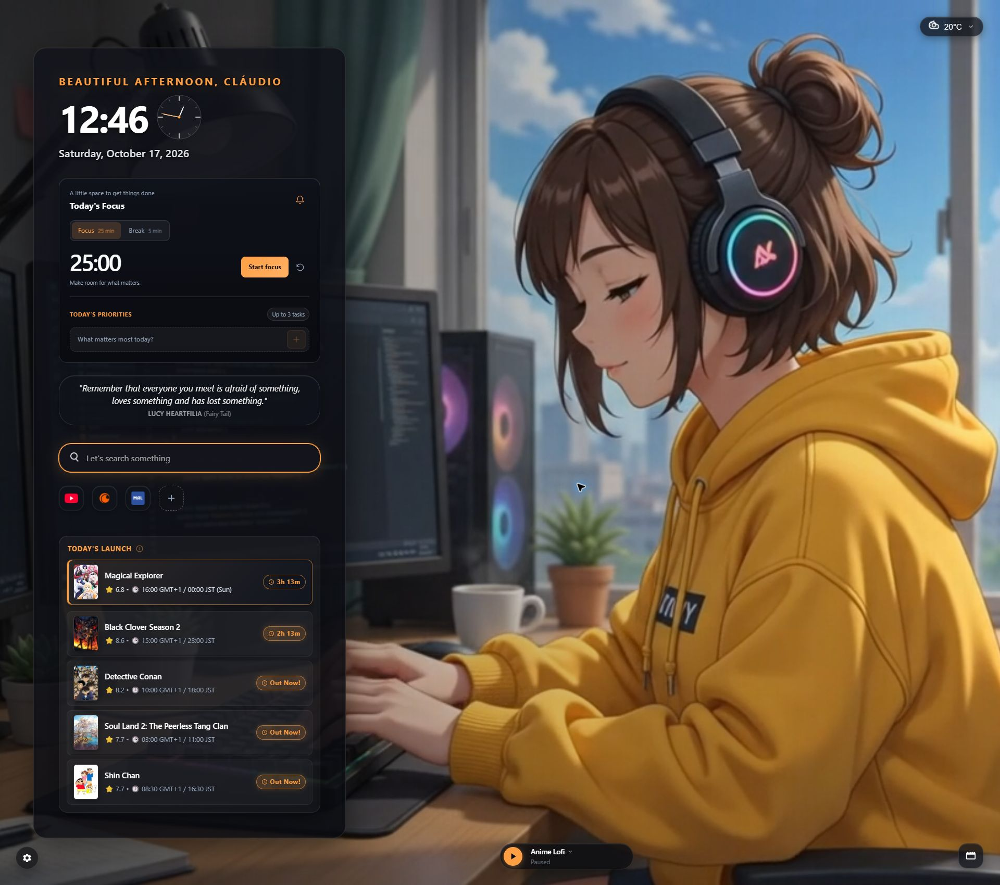
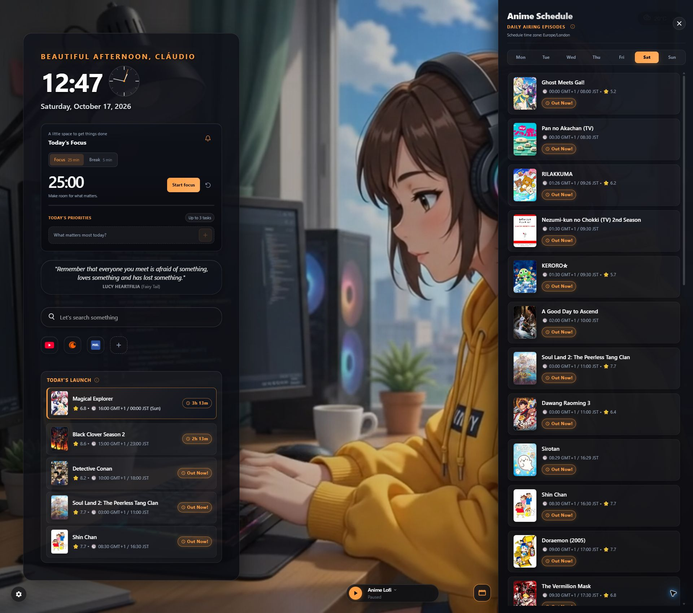
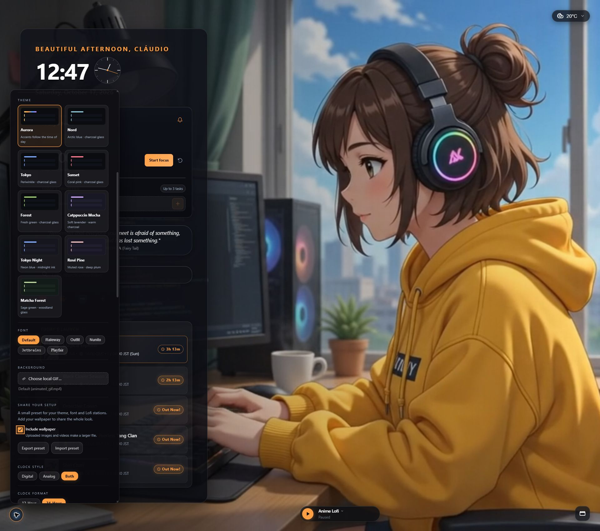
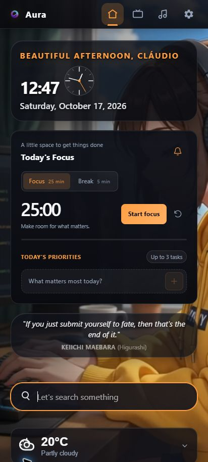
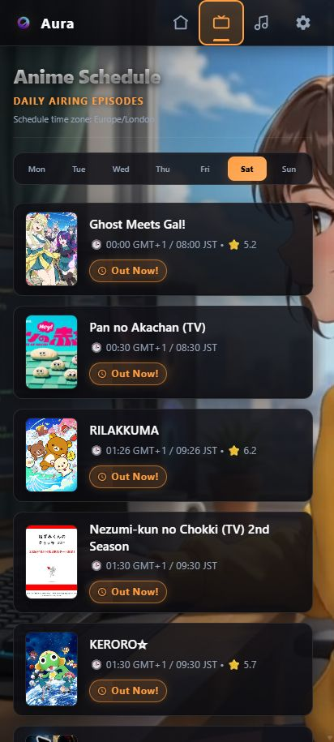
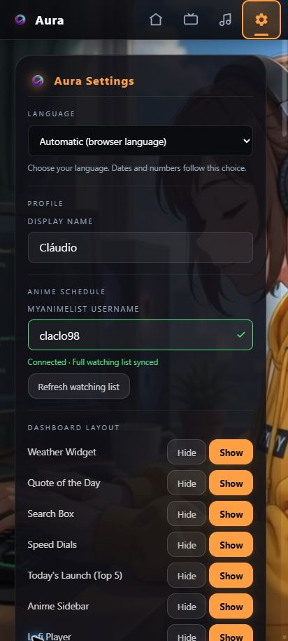

<div align="center">

# ✨ Aura Dashboard

**Your personal space to focus, relax, and keep up with your day.**

A customizable start page with a focus timer, daily priorities, weather, anime schedules, Lofi music, and animated wallpapers. No Aura account required.

[](https://claudiogarcia98.github.io/Aura-Dashboard/)
[](https://github.com/ClaudioGarcia98/Aura-Dashboard/releases/tag/v1.2.0)
[](https://github.com/ClaudioGarcia98/Aura-Dashboard/actions/workflows/deploy.yml)
[](https://buymeacoffee.com/claudio091s)

</div>

## Get started

1. **[Open Aura in your browser](https://claudiogarcia98.github.io/Aura-Dashboard/)**. You don't need to install anything or run commands.
2. **Open Settings** using the gear at the bottom-left on desktop, or the **Settings** tab on smaller screens.
3. **Make it yours**: add your name, choose a theme and wallpaper, and select the widgets you want under **Dashboard Layout**.
4. **Bookmark Aura** for easy access. You can also set its address as your browser's home or startup page.

Changes save automatically in the browser you're using. An internet connection is needed for live weather, anime schedules, and YouTube music or trailers.

## What you can do

| Feature | How it helps |
| :--- | :--- |
| **Today's Focus** | Work in 25-minute sessions, take 5-minute breaks, and keep up to three daily priorities. |
| **Weather** | See current conditions in words and icons, plus a three-day forecast. |
| **Anime schedules** | Browse today's top five releases and the weekly schedule in your chosen time zone. |
| **MyAnimeList** | Enter your public username to highlight airing shows from your Watching list. |
| **Lofi music** | Choose a built-in station or add your own YouTube station. |
| **Search and Speed Dials** | Search your favorite sites and keep frequently used links close by. |
| **Themes and wallpapers** | Choose from nine themes and six fonts, or upload your own image or video background. |
| **Language and clocks** | Choose from eight languages, digital or analog clocks, and automatic or manual time zones. |
| **Presets and backups** | Share your dashboard's appearance or save a backup of your preferences. |

## 🖥️ A look at Aura

### Desktop dashboard with Today's Focus



### Anime schedules and themes

| 📺 Weekly Anime Schedule with Local Time Zones | 🎨 Nine Themes in One Gallery |
| :---: | :---: |
|  |  |

### On your phone

| 📱 Home & Focus Timer | 📅 Anime Schedule | ⚙️ Settings |
| :---: | :---: | :---: |
|  |  |  |

Captured directly from the [live GitHub Pages app](https://claudiogarcia98.github.io/Aura-Dashboard/) on **October 17, 2026**, at **1920 × 1700** (complete desktop dashboard) and a **412 × 915** phone viewport. The wallpaper is animated, so its frame and time-based accent colors can vary.

---

## Using Aura

### Focus timer and daily priorities

In **Today's Focus**, choose **Focus** or **Break**, then press **Start focus** or **Start break**. You can pause, resume, or reset the timer at any time. The next session waits for you to start it.

- Add up to three priorities and check them off as you finish.
- The bell switches the completion sound on or off. Turning it on plays a preview. The sound is independent of the music volume; it does not send desktop notifications.
- Keep Aura open to hear the completion sound. Your browser or device can delay timers or silence audio while asleep or suspended.
- Your timer and priorities survive a page reload. An elapsed timer catches up when you return; audio after reopening may require a click or keypress first.
- Priorities clear at midnight in your selected time zone. Changing time zones preserves your current priorities.

To hide the card, turn off **Settings → Dashboard Layout → Focus Timer & Tasks**. Hiding it also pauses a running timer.

### Weather and location

Click or tap the weather widget to see feels-like temperature, humidity, wind, sunrise, sunset, and the three-day forecast. Current conditions and forecast icons include text descriptions.

Under **Settings → Weather**, choose Celsius or Fahrenheit and set **Your City** by selecting a search result. This city is a fallback when GPS is unavailable; it does not turn automatic location off.

| Situation | What happens |
| :--- | :--- |
| Location permission is granted | Weather uses your location without another permission prompt. |
| Temporary permission expired before reopening | Aura can ask once again when weather starts. |
| Permission expires while Aura is open | Aura keeps the last known location instead of repeatedly interrupting weather refreshes. |
| Permission is blocked or GPS fails | Aura uses your saved city. With no saved city, it tries approximate IP location, then London if needed. |
| Weather is disabled | Aura does not request location for weather. |

Browser location permissions are separate from Aura settings. Resetting Aura clears saved coordinates but leaves browser permission unchanged. To block access or allow it again, use your browser's site permissions.

### Anime and MyAnimeList

Open the anime sidebar on desktop or the **Anime** tab on smaller screens to browse the weekly schedule. **Today's Launch** shows up to five of today's releases on the home screen.

Enter your **MyAnimeList Username** under **Settings → Anime Schedule** to highlight shows on your public Watching list. You do not need to enter your password or sign in through Aura. Refresh the connection after updating your list.

Hover over a supported anime card on desktop, or expand it on touch screens, to watch its trailer. Synopses are supplied in English, even when you choose another interface language.

### Search and favorite links

Press **Ctrl + Space** to focus search. Type normally for the default search, or use a site prefix followed by a space:

| Example | Searches |
| :--- | :--- |
| `yt lofi hip hop` | YouTube |
| `mal frieren` | MyAnimeList |
| `gh react` | GitHub |
| `r anime` | Reddit |
| `ddg cozy desk` | DuckDuckGo |
| `wiki pomodoro` | Wikipedia |

Use **Settings → Speed Dials** to add and organize your favorite links. Online search suggestions are optional and off by default; enable them under **Privacy & Motion**.

### Music, appearance, and language

- **Music:** press Play in the Lofi player, choose a station, and adjust its volume. Add custom YouTube stations under **Lofi Stations** in Settings.
- **Appearance:** choose a theme and font in Settings, then upload an image or video under **Background**. Use **Privacy & Motion → Pause background video** for a still background.
- **Language:** choose English, Portuguese (Portugal or Brazil), Spanish, French, German, Japanese, or Korean. **Automatic** follows a supported browser language, with English as the fallback.
- **Time zone:** **Automatic** follows your device without requesting location. A manual override changes the clock, date, greeting, anime schedule, and midnight reset for daily priorities. Japan time is an optional schedule reference.

### Save, share, or reset your setup

| What you want | Where to go | What is included |
| :--- | :--- | :--- |
| Back up your preferences | **Settings → Backup & Restore → Export Settings** | Preferences, Speed Dials, and custom stations. Uploaded wallpapers and focus tasks are not included. |
| Restore a settings backup | **Settings → Backup & Restore → Import Settings** | Choose your exported JSON file, then reload when prompted. |
| Share your dashboard's appearance | **Settings → Share your setup → Export preset** | Theme, font, and Lofi stations. **Include wallpaper** can add your uploaded image or video, up to 50 MB. |
| Try someone else's appearance preset | **Settings → Share your setup → Import preset** | Preview it, then choose **Apply preset**. Your profile, tasks, language, time zone, volume, and layout stay as they are. |
| Start over | **Settings → Danger Zone** | After confirmation, Aura clears its saved settings, tasks, caches, and uploaded background, then reloads. Browser permissions remain unchanged. |

## Your data and privacy

Your preferences and uploaded backgrounds are saved in your browser, with no Aura account or cloud sync. Another browser, profile, device, or site address has its own saved setup. Clearing site data can erase your customization, so export a backup before changing browsers or resetting data. Save your original wallpaper separately or include it in an appearance preset.

Live features connect to external services: Open-Meteo for weather and city search, AniList for anime schedules, MyAnimeList through a relay for public watchlists, YouTube for music and trailers, and IP geolocation when needed. Enabling online search suggestions sends your search text to Google.

## Troubleshooting

- **No music or completion sound?** Click Play or Start, check that the browser tab and device aren't muted, and make sure the focus bell is on. Music volume and the completion bell are separate controls.
- **Weather shows the wrong place?** Check the browser's location permission and select your fallback city under **Settings → Weather**. A fallback city is used when GPS is unavailable.
- **Schedule times look wrong?** Check **Settings → Time zone** and your device's clock. Japan reference times can show a different date.
- **MyAnimeList highlights are missing?** Check the username, confirm your Watching list is public, and refresh the connection.
- **A live widget won't update?** Check your connection. Saved weather or schedules may stay visible while a service is unavailable.
- **Settings disappeared?** Make sure you're using the same browser profile and site address. Restore an exported settings backup if you have one.

## Run locally or develop Aura

<details>
<summary>Installation, checks, and technical notes</summary>

### Requirements

Use **Node.js 22.22.2+ in the 22.x line, 24.15+ in the 24.x line, or 26+**, with npm.

### Start locally

```sh
git clone https://github.com/ClaudioGarcia98/Aura-Dashboard.git
cd Aura-Dashboard
npm ci
npm run dev
```

Open the URL printed in the terminal, usually `http://localhost:5173`.

### Development commands

| Command | Purpose |
| :--- | :--- |
| `npm run dev` | Start the local development server. |
| `npm run lint` | Check JavaScript and React code with ESLint. |
| `npm test` | Run unit and integration tests. |
| `npm run build` | Create and verify the self-contained `dist/index.html` production build. |
| `npm run preview` | Serve the production build locally. |
| `npm run test:browser` | Run production browser checks with Playwright. |
| `npm audit` | Check dependency security advisories. |

Before the first browser test run, install Chromium with `npx playwright install chromium`, then run `npm run build` and `npm run test:browser`.

Aura uses React, Vite, and Zustand. Preferences and caches use browser storage; uploaded backgrounds use IndexedDB. The production build bundles the app into one HTML file with verified Content Security Policy script hashes. Live services still require a network connection.

Development requests to `/api/mal` use Vite's proxy. The hosted app uses a Cloudflare Worker; see [the relay documentation](workers/mal/README.md). Translation sources are in `src/i18n/messages.js` and `src/i18n/quotes.js`; keep all language entries and named placeholders complete.

</details>

## ☕ Support the Project

Aura is free to use. If it makes your day a little better, you can support its continued development:

- ☕ [**Buy Me a Coffee**](https://buymeacoffee.com/claudio091s)

## 📄 License

Copyright © 2026 Cláudio Garcia. All Rights Reserved.  
This project and its source code are proprietary. See [LICENSE](LICENSE) for the terms and [SECURITY.md](.github/SECURITY.md) for reporting security issues.
